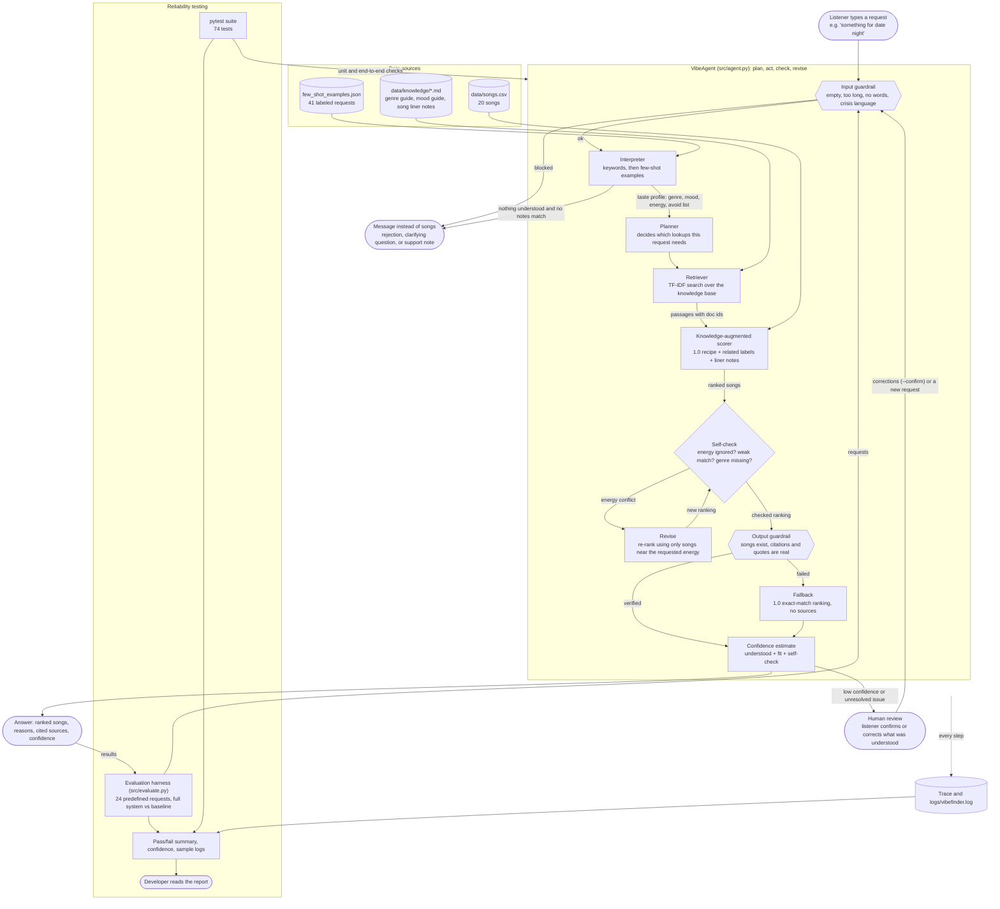

# 🎵 VibeFinder 2.0: an explainable music recommender agent

Tell VibeFinder what you feel like listening to in plain English. It works out what you meant, looks up what it knows about that kind of music, ranks a song catalog, checks its own answer, and tells you how confident it is and which sources it used.

```
$ python -m src.main "something for date night"
...
1. Velvet Hours by Amara Lux [r&b, romantic]  score 3.15
     - mood match: romantic (+1.00)
     - energy 0.52 vs target 0.50 (+1.47)
     - liner notes match your request (+0.68) [song_notes.md#velvet-hours]
       "Smooth vocals over a slow groove."
...
Confidence: 1.00 (high)
```

Recommenders decide what people see, so the interesting question is not only "what did it pick" but "why, how sure is it, and what happens when it is wrong". This project is built around those three questions. It runs on the Python standard library alone: no API key, no model download, and the same input always gives the same output.

Final project for CodePath AI110 (Foundations of AI Engineering), Fall 2026.

---

## Base project

This project extends my Module 3 project, **Music Recommender Simulation (VibeFinder 1.0)**: <https://github.com/Thorkungs/ai110-module3show-musicrecommendersimulation-starter>

VibeFinder 1.0 loaded a 20 song catalog from a CSV file and scored every song against a fixed taste profile (favorite genre, favorite mood, target energy, optional acoustic preference) with a weighted recipe, then printed the top 5 with the reason for each point. It was a content-based recommender with seven hard-coded test profiles, a weight experiment, and a model card documenting its biases.

Its own model card listed the weaknesses this project goes after:

| Weakness found in 1.0 | What 2.0 does about it |
| --- | --- |
| The user had to supply exact labels in code (`{"genre": "pop", "mood": "happy"}`) | Takes a free text request and interprets it |
| "indie pop" earned nothing for a "pop" fan, so Gym Hero outranked Rooftop Lights for a happy pop listener | Retrieves a genre guide and gives related genres half credit, with a citation |
| A k-pop fan could never earn the genre bonus | The genre guide maps genres missing from the catalog to their closest neighbors |
| "Sad folk at 0.9 energy" confidently returned a 0.30 energy song | A self-check notices the conflict, tries to fix it, and flags the answer for review if it cannot |
| No way to tell a good answer from a bad one | Confidence score, guardrails, an evaluation harness, and 74 automated tests |

The original scoring function is still in `src/recommender.py`, unchanged, and still runs with `python -m src.main --profile chill_lofi`.

---

## What is new

| AI feature | Where | What it changes in the system |
| --- | --- | --- |
| **Retrieval-augmented recommendation (RAG)** | `src/retriever.py`, `src/rag_scoring.py`, `data/knowledge/` | Three document sources (genre guide, mood guide, song liner notes) are searched for every request. What is retrieved changes the scores, so it changes the ranking, and every knowledge-based reason carries a citation to the passage it came from. |
| **Agentic workflow** | `src/agent.py` | The agent plans which lookups a request needs, acts, checks its own top pick, and revises the ranking when a stated preference was ignored. Every step is recorded in a trace. |
| **Specialized interpreter (few-shot)** | `src/interpreter.py`, `data/few_shot_examples.json` | 41 labeled example requests let the system understand situations ("heading to the gym") and not only labels. It abstains when the nearest examples disagree. |
| **Reliability system** | `src/guardrails.py`, `src/evaluate.py`, `tests/` | Input and output guardrails, a 0 to 1 confidence score, human review for low-confidence answers, a file log, an evaluation harness, and a pytest suite. |

---

## Architecture overview

The diagram source is in [`diagrams/architecture.mmd`](diagrams/architecture.mmd).



How a request moves through the system:

1. **Input guardrail** (`check_request`). Empty, overlong and wordless requests are rejected. Crisis language gets a support message and no playlist.
2. **Interpreter**. A keyword stage reads labels, energy words and negation ("anything but pop"). A few-shot stage then fills missing slots from the most similar labeled examples.
3. **Planner**. Builds the list of steps this request needs. A request with no energy level, for example, gets a step to take a typical energy from the guides.
4. **Retriever**. TF-IDF search over the knowledge base returns the genre guide, the mood guide and up to five liner notes, each with a document id.
5. **Knowledge-augmented scorer**. Starts from the 1.0 recipe, then adds half credit for related genres and moods, an energy target taken from the guide when none was stated, and a bonus for liner notes that match the request.
6. **Self-check and revision**. If the top pick is more than 0.30 away from the requested energy, the agent re-ranks using only songs near that energy. It keeps the new ranking only if the new top pick still fits the rest of the request.
7. **Output guardrail** (`verify_output`). Every song must exist in the catalog, every citation must point at a passage that was retrieved, and every quote must appear in that passage. If any check fails, the agent falls back to the 1.0 exact-match ranking and says so.
8. **Confidence and human review**. `confidence = 0.4 × understood + 0.4 × fit + 0.2 × self-check`. Answers below 0.5, or with an unresolved issue, are marked "please review". With `--confirm` a person can correct what was understood before anything is ranked.

Testing sits outside the agent: `src/evaluate.py` feeds it 24 predefined requests and compares the results with expectations, and the pytest suite checks each component. A person reads those reports.

---

## Setup

Requires Python 3.9 or newer. The only dependency is `pytest`, for the tests.

```bash
git clone https://github.com/Thorkungs/applied-ai-system-final.git
cd applied-ai-system-final
python3 -m venv .venv
source .venv/bin/activate        # Windows PowerShell: .\.venv\Scripts\Activate.ps1
python -m pip install --upgrade pip
pip install -r requirements.txt
```

## Running it

```bash
python -m src.main "chill lofi for studying"          # ask for music in plain English
python -m src.main "happy k-pop" --trace              # also print every step the agent took
python -m src.main "happy k-pop" --baseline           # same request, retrieval and few-shot off
python -m src.main "sad folk songs" --confirm         # review what was understood before ranking
python -m src.main --interactive                      # keep asking until you type quit
python -m src.main "music for the gym" -k 5           # ask for 5 songs (1 to 10)

python -m src.evaluate                                # evaluation harness with pass/fail summary
pytest                                                # 74 automated tests

python -m src.main --profile chill_lofi               # the original 1.0 fixed profiles
```

Each run appends its steps to `logs/vibefinder.log`.

---

## Sample interactions

All output below is pasted from real runs. The same runs, plus more, are saved as text files in [`assets/sample_runs/`](assets/sample_runs/).

### 1. Explicit labels, with the full agent trace

```
$ python -m src.main "happy pop songs" --trace
========================================================================
Request:    happy pop songs
Understood: genre=pop (keyword) | mood=happy (keyword)
Plan:
  1. look up the genre guide for 'pop' (neighbors, typical energy)
  2. look up the mood guide for 'happy' (neighbors, typical energy)
  3. search the song liner notes for the wording of the request
  4. no energy level stated, so take a typical energy from the guides
  5. score all 20 songs and rank them
  6. self-check the top results and re-rank if a stated preference was ignored
  7. verify songs, citations and quotes before answering
------------------------------------------------------------------------
Top 3 of 20 songs
1. Sunrise City by Neon Echo [pop, happy]  score 3.70
     - genre match: pop (+2.00)
     - mood match: happy (+1.00)
     - energy 0.82 vs typical 0.75 from the guide (+0.70) [moods.md#happy]
2. Rooftop Lights by Indigo Parade [indie pop, happy]  score 2.74
     - mood match: happy (+1.00)
     - related genre: indie pop is close to pop (+1.00) [genres.md#pop]
       "Pop is hook driven and polished, built around a big sing-along chorus and bright production."
     - energy 0.76 vs typical 0.75 from the guide (+0.74) [moods.md#happy]
3. Gym Hero by Max Pulse [pop, intense]  score 2.62
     - genre match: pop (+2.00)
     - energy 0.93 vs typical 0.75 from the guide (+0.61) [moods.md#happy]
------------------------------------------------------------------------
Self-check: no issues
Confidence: 0.99 (high)
Sources:    moods.md#happy, genres.md#pop
------------------------------------------------------------------------
Agent trace
  [1] guardrail check_request       ok (15 chars)
  [2] act       interpret_request   genre=pop (keyword) | mood=happy (keyword)
  [3] plan      make_plan           7 steps
                                    - look up the genre guide for 'pop' (neighbors, typical energy)
                                    - look up the mood guide for 'happy' (neighbors, typical energy)
                                    - search the song liner notes for the wording of the request
                                    - no energy level stated, so take a typical energy from the guides
                                    - score all 20 songs and rank them
                                    - self-check the top results and re-rank if a stated preference was ignored
                                    - verify songs, citations and quotes before answering
  [4] act       retrieve_knowledge  genres.md#pop, moods.md#happy
  [5] act       score_catalog       Sunrise City 3.70, Rooftop Lights 2.74, Gym Hero 2.62
  [6] check     self_check          no issues
  [7] guardrail verify_output       ok (3 songs in catalog, 4 citations checked)
  [8] act       estimate_confidence 0.99 (high)
```

Rooftop Lights (indie pop, happy) now ranks above Gym Hero (pop, intense). In 1.0 it was the other way round, because "indie pop" did not equal "pop". The half credit comes from the retrieved pop guide and is cited.

### 2. A situation instead of labels (few-shot interpreter)

```
$ python -m src.main "heading to the gym for leg day"
========================================================================
Request:    heading to the gym for leg day
Understood: mood=intense (few-shot 0.78) | energy=0.92 (few-shot 0.78)
Plan:
  1. look up the mood guide for 'intense' (neighbors, typical energy)
  2. search the song liner notes for the wording of the request
  3. score all 20 songs and rank them
  4. self-check the top results and re-rank if a stated preference was ignored
  5. verify songs, citations and quotes before answering
------------------------------------------------------------------------
Top 3 of 20 songs
1. Gym Hero by Max Pulse [pop, intense]  score 2.96
     - mood match: intense (+1.00)
     - energy 0.93 vs target 0.92 (+1.48)
     - liner notes match your request (+0.48) [song_notes.md#gym-hero]
       "Punchy bass and shouted hooks engineered for the last rep."
2. Storm Runner by Voltline [rock, intense]  score 2.48
     - mood match: intense (+1.00)
     - energy 0.91 vs target 0.92 (+1.48)
3. Iron Cathedral by Black Anvil [metal, angry]  score 1.93
     - energy 0.97 vs target 0.92 (+1.43)
     - related mood: angry is close to intense (+0.50) [moods.md#intense]
       "Intense songs are hard hitting and driving, made to push you."
------------------------------------------------------------------------
Self-check: no issues
Confidence: 0.91 (high)
Sources:    song_notes.md#gym-hero, moods.md#intense
```

The request names no genre or mood. The interpreter matched it to the example "music for the gym" and took mood and energy from there.

### 3. Retrieval using a second source at the same time

```
$ python -m src.main "jazz for sunday morning coffee"
========================================================================
Request:    jazz for sunday morning coffee
Understood: genre=jazz (keyword) | mood=relaxed (few-shot 1.00) | energy=0.40 (few-shot 1.00)
Plan:
  1. look up the genre guide for 'jazz' (neighbors, typical energy)
  2. look up the mood guide for 'relaxed' (neighbors, typical energy)
  3. search the song liner notes for the wording of the request
  4. score all 20 songs and rank them
  5. self-check the top results and re-rank if a stated preference was ignored
  6. verify songs, citations and quotes before answering
------------------------------------------------------------------------
Top 3 of 20 songs
1. Coffee Shop Stories by Slow Stereo [jazz, relaxed]  score 5.39
     - genre match: jazz (+2.00)
     - mood match: relaxed (+1.00)
     - energy 0.37 vs target 0.40 (+1.46)
     - liner notes match your request (+0.94) [song_notes.md#coffee-shop-stories]
       "Brushed drums, upright bass and a mellow saxophone."
2. Midnight Coding by LoRoom [lofi, chill]  score 2.97
     - energy 0.42 vs target 0.40 (+1.47)
     - related genre: lofi is close to jazz (+1.00) [genres.md#jazz]
       "Jazz is built on improvisation, swing and rich chords, played on instruments such as saxophone, piano and upright bass."
     - related mood: chill is close to relaxed (+0.50) [moods.md#relaxed]
       "Relaxed songs are easy going and comfortable, like an unhurried morning."
3. Library Rain by Paper Lanterns [lofi, chill]  score 2.92
     - energy 0.35 vs target 0.40 (+1.42)
     - related genre: lofi is close to jazz (+1.00) [genres.md#jazz]
       "Jazz is built on improvisation, swing and rich chords, played on instruments such as saxophone, piano and upright bass."
     - related mood: chill is close to relaxed (+0.50) [moods.md#relaxed]
       "Relaxed songs are easy going and comfortable, like an unhurried morning."
------------------------------------------------------------------------
Self-check: no issues
Confidence: 1.00 (high)
Sources:    song_notes.md#coffee-shop-stories, genres.md#jazz, moods.md#relaxed
```

---

## What retrieval adds: before and after

The `--baseline` flag switches off retrieval and the few-shot stage, which leaves 1.0 style exact matching. The same request, both ways:

**Before (no retrieval):** the catalog has no k-pop, so only the mood can match.

```
$ python -m src.main "happy k-pop" --baseline
========================================================================
Request:    happy k-pop
Understood: genre=k-pop (keyword) | mood=happy (keyword)
Plan:
  1. knowledge retrieval is off, so use exact label matching only
  2. score all 20 songs and rank them
  3. self-check the top results and re-rank if a stated preference was ignored
  4. verify songs, citations and quotes before answering
------------------------------------------------------------------------
Top 2 of 20 songs
1. Rooftop Lights by Indigo Parade [indie pop, happy]  score 1.00
     - mood match: happy (+1.00)
2. Sunrise City by Neon Echo [pop, happy]  score 1.00
     - mood match: happy (+1.00)
------------------------------------------------------------------------
Self-check: genre_unavailable, weak_match
Note:       The catalog has no k-pop songs, so the genre could not be matched at all.
Note:       Even the best song is a weak match for what you asked, so treat these as rough suggestions.
Confidence: 0.45 (low)  ->  please review, I am not sure about this one
```

**After (with retrieval):** the k-pop guide says pop, edm and hip hop are the closest genres, so those songs earn credit, and the answer says where that came from.

```
$ python -m src.main "happy k-pop"
========================================================================
Request:    happy k-pop
Understood: genre=k-pop (keyword) | mood=happy (keyword)
Plan:
  1. look up the genre guide for 'k-pop' (neighbors, typical energy)
  2. look up the mood guide for 'happy' (neighbors, typical energy)
  3. search the song liner notes for the wording of the request
  4. no energy level stated, so take a typical energy from the guides
  5. score all 20 songs and rank them
  6. self-check the top results and re-rank if a stated preference was ignored
  7. verify songs, citations and quotes before answering
------------------------------------------------------------------------
Top 3 of 20 songs
1. Sunrise City by Neon Echo [pop, happy]  score 2.70
     - mood match: happy (+1.00)
     - related genre: pop is close to k-pop (+1.00) [genres.md#k-pop]
       "K-pop is Korean pop music: highly produced, upbeat and choreography driven, mixing pop choruses with edm drops and hip hop verses."
     - energy 0.82 vs typical 0.75 from the guide (+0.70) [moods.md#happy]
2. Laser Bloom by Pulse Garden [edm, euphoric]  score 2.10
     - related genre: edm is close to k-pop (+1.00) [genres.md#k-pop]
       "K-pop is Korean pop music: highly produced, upbeat and choreography driven, mixing pop choruses with edm drops and hip hop verses."
     - related mood: euphoric is close to happy (+0.50) [moods.md#happy]
       "Happy songs are bright, warm and feel good."
     - energy 0.95 vs typical 0.75 from the guide (+0.60) [moods.md#happy]
3. Rooftop Lights by Indigo Parade [indie pop, happy]  score 1.74
     - mood match: happy (+1.00)
     - energy 0.76 vs typical 0.75 from the guide (+0.74) [moods.md#happy]
------------------------------------------------------------------------
Self-check: genre_unavailable
Note:       The catalog has no k-pop songs. Using the closest genres from the guide instead: pop, edm, hip hop.
Confidence: 0.79 (medium)
Sources:    genres.md#k-pop, moods.md#happy
```

A request with no labels at all shows the same difference. Without retrieval the system can only ask for more detail. With it, the liner notes source finds a match:

```
$ python -m src.main "rainy afternoon reading" --baseline
========================================================================
Request:    rainy afternoon reading
Status:     clarify
------------------------------------------------------------------------
I need a little more to go on: I couldn't find a music preference in that. Tell me a genre, a mood, an energy level, or what you're doing, for example: 'chill lofi for studying' or 'something for the gym'.
```

```
$ python -m src.main "rainy afternoon reading"
========================================================================
Request:    rainy afternoon reading
Understood: nothing I can score
Plan:
  1. search the song liner notes for the wording of the request
  2. score all 20 songs and rank them
  3. self-check the top results and re-rank if a stated preference was ignored
  4. verify songs, citations and quotes before answering
------------------------------------------------------------------------
Top 3 of 20 songs
1. Library Rain by Paper Lanterns [lofi, chill]  score 1.00
     - liner notes match your request (+1.00) [song_notes.md#library-rain]
       "Soft piano over recorded rainfall and turning pages."
2. Rainy Day Blues by Delta Mae [blues, sad]  score 0.48
     - liner notes match your request (+0.48) [song_notes.md#rainy-day-blues]
       "Slide guitar and a weary voice singing about bad luck."
3. Rooftop Lights by Indigo Parade [indie pop, happy]  score 0.26
     - liner notes match your request (+0.26) [song_notes.md#rooftop-lights]
       "Jangly guitars, handclaps and a feel good chorus about summer nights with friends."
------------------------------------------------------------------------
Self-check: no issues
Confidence: 0.60 (medium)
Sources:    song_notes.md#library-rain, song_notes.md#rainy-day-blues, song_notes.md#rooftop-lights
```

Across the 24 evaluation cases, the full system passes 23 and the no-retrieval, no-few-shot baseline passes 13 (see [Evaluation](#evaluation-results)).

---

## Agent behavior: self-check and revision

**A conflict the agent can fix.** Both pop songs in the catalog are high energy. The first ranking ignores "calm", the self-check catches it, and the revision finds a pop-adjacent song at lower energy.

```
$ python -m src.main "pop but really calm and low energy" --trace
========================================================================
Request:    pop but really calm and low energy
Understood: genre=pop (keyword) | energy=0.30 (keyword)
Plan:
  1. look up the genre guide for 'pop' (neighbors, typical energy)
  2. search the song liner notes for the wording of the request
  3. score all 20 songs and rank them
  4. self-check the top results and re-rank if a stated preference was ignored
  5. verify songs, citations and quotes before answering
------------------------------------------------------------------------
Top 3 of 20 songs
1. Velvet Hours by Amara Lux [r&b, romantic]  score 2.17
     - energy 0.52 vs target 0.30 (+1.17)
     - related genre: r&b is close to pop (+1.00) [genres.md#pop]
       "Pop is hook driven and polished, built around a big sing-along chorus and bright production."
2. Cabin Letters by Willow & Pine [folk, sad]  score 1.50
     - energy 0.30 vs target 0.30 (+1.50)
3. Spacewalk Thoughts by Orbit Bloom [ambient, chill]  score 1.47
     - energy 0.28 vs target 0.30 (+1.47)
------------------------------------------------------------------------
Self-check: found a problem with the first ranking and revised it
Note:       My first ranking put Sunrise City (energy 0.82) on top although you asked for about 0.30, so I re-ranked using only songs near that energy.
Confidence: 0.75 (medium)
Sources:    genres.md#pop
------------------------------------------------------------------------
Agent trace
  [1] guardrail check_request       ok (34 chars)
  [2] act       interpret_request   genre=pop (keyword) | energy=0.30 (keyword)
  [3] plan      make_plan           5 steps
                                    - look up the genre guide for 'pop' (neighbors, typical energy)
                                    - search the song liner notes for the wording of the request
                                    - score all 20 songs and rank them
                                    - self-check the top results and re-rank if a stated preference was ignored
                                    - verify songs, citations and quotes before answering
  [4] act       retrieve_knowledge  genres.md#pop
  [5] act       score_catalog       Sunrise City 2.72, Gym Hero 2.56, Velvet Hours 2.17
  [6] check     self_check          energy_conflict
  [7] revise    rerank              only songs within 0.30 of energy 0.30: Velvet Hours 2.17, Cabin Letters 1.50, Spacewalk Thoughts 1.47
  [8] check     self_check          no issues after revision
  [9] guardrail verify_output       ok (3 songs in catalog, 1 citations checked)
  [10] act       estimate_confidence 0.75 (medium)
```

**A conflict the agent cannot fix.** Nothing in the catalog is both sad folk and high energy. The agent keeps the label match, says so plainly, names the closest song by energy, caps its confidence and asks for review. In 1.0 this request returned Cabin Letters with no warning.

```
$ python -m src.main "sad folk songs but high energy" --trace
========================================================================
Request:    sad folk songs but high energy
Understood: genre=folk (keyword) | mood=sad (keyword) | energy=0.90 (keyword)
Plan:
  1. look up the genre guide for 'folk' (neighbors, typical energy)
  2. look up the mood guide for 'sad' (neighbors, typical energy)
  3. search the song liner notes for the wording of the request
  4. score all 20 songs and rank them
  5. self-check the top results and re-rank if a stated preference was ignored
  6. verify songs, citations and quotes before answering
------------------------------------------------------------------------
Top 3 of 20 songs
1. Cabin Letters by Willow & Pine [folk, sad]  score 3.60
     - genre match: folk (+2.00)
     - mood match: sad (+1.00)
     - energy 0.30 vs target 0.90 (+0.60)
2. Rainy Day Blues by Delta Mae [blues, sad]  score 2.81
     - mood match: sad (+1.00)
     - energy 0.44 vs target 0.90 (+0.81)
     - related genre: blues is close to folk (+1.00) [genres.md#folk]
       "Folk is quiet acoustic music, usually a voice and a fingerpicked guitar telling a personal story."
3. Dusty Back Roads by Tumbleweed Kings [country, nostalgic]  score 1.98
     - energy 0.55 vs target 0.90 (+0.98)
     - related genre: country is close to folk (+1.00) [genres.md#folk]
       "Folk is quiet acoustic music, usually a voice and a fingerpicked guitar telling a personal story."
------------------------------------------------------------------------
Self-check: energy_conflict
Note:       Nothing in the catalog is both sad folk and near energy 0.90. The top pick matches your labels but not the energy; the closest song by energy alone is Storm Runner (rock, intense, energy 0.91).
Confidence: 0.45 (low)  ->  please review, I am not sure about this one
Sources:    genres.md#folk
------------------------------------------------------------------------
Agent trace
  [1] guardrail check_request       ok (30 chars)
  [2] act       interpret_request   genre=folk (keyword) | mood=sad (keyword) | energy=0.90 (keyword)
  [3] plan      make_plan           6 steps
                                    - look up the genre guide for 'folk' (neighbors, typical energy)
                                    - look up the mood guide for 'sad' (neighbors, typical energy)
                                    - search the song liner notes for the wording of the request
                                    - score all 20 songs and rank them
                                    - self-check the top results and re-rank if a stated preference was ignored
                                    - verify songs, citations and quotes before answering
  [4] act       retrieve_knowledge  genres.md#folk, moods.md#sad
  [5] act       score_catalog       Cabin Letters 3.60, Rainy Day Blues 2.81, Dusty Back Roads 1.98
  [6] check     self_check          energy_conflict
  [7] revise    rerank              no song near energy 0.90 fits the rest of the request and its stated labels (best was Night Drive Loop 1.77), keeping the first ranking
  [8] guardrail verify_output       ok (3 songs in catalog, 2 citations checked)
  [9] act       estimate_confidence 0.45 (low), flagged for human review
```

More traces are saved in [`ai_interactions.md`](ai_interactions.md).

---

## Guardrails and reliability

| Input | What the system does | Result |
| --- | --- | --- |
| `""` (empty) | Input guardrail rejects it before any work is done | `rejected`, no songs |
| `"?!?!?! 12345"` | Input guardrail: no words found | `rejected`, no songs |
| A 323 character request | Input guardrail: over the 300 character limit | `rejected`, no songs |
| `"what is the capital of France"` | Nothing understood and no liner notes match, so it asks instead of guessing | `clarify`, no songs |
| `"I want to die, play something sad"` | Crisis language: responds with a support message and the 988 lifeline, not a sad playlist | `support`, no songs |
| `"upbeat music, anything but pop"` | Negation is read as "avoid pop"; the output guardrail re-checks that no pop song is returned | `ok`, 3 songs, none pop |
| `"sad folk songs but high energy"` | Self-check finds a conflict it cannot fix | `needs_review`, confidence 0.45 |
| `"pumping iron"` | Not understood; one liner note matches weakly | `needs_review`, confidence 0.43 |
| Ranking step returns a song that is not in the catalog (simulated in `tests/test_agent.py`) | Output guardrail fails verification and falls back to the exact-match ranking | `degraded`, confidence capped at 0.40 |
| A catalog row with `energy = 8.0` (simulated in tests) | Row is dropped with a logged warning and the rest of the catalog still works | 1 of 2 songs loaded |
| Unexpected exception inside the agent (simulated in tests) | Caught, logged with a traceback, user sees a plain message | `error`, no songs |

Real output for four of these:

```
$ python -m src.main ""
========================================================================
Request:    (empty)
Status:     rejected
------------------------------------------------------------------------
Request not accepted: Please type what you feel like listening to.
```

```
$ python -m src.main "what is the capital of France"
========================================================================
Request:    what is the capital of France
Status:     clarify
------------------------------------------------------------------------
I need a little more to go on: I couldn't find a music preference in that. Tell me a genre, a mood, an energy level, or what you're doing, for example: 'chill lofi for studying' or 'something for the gym'.
```

```
$ python -m src.main "I want to die, play something sad"
========================================================================
Request:    I want to die, play something sad
Status:     support
------------------------------------------------------------------------
A note before any music: It sounds like you might be going through something really painful. I'm only a music recommender and can't help with this the way a person can. If you are in the US you can call or text 988 (Suicide & Crisis Lifeline) at any time. Anywhere else, please reach out to a local crisis line or someone you trust. If you would just like some calm music, ask me for that and I'll find some.
```

```
$ python -m src.main "upbeat music, anything but pop"
========================================================================
Request:    upbeat music, anything but pop
Understood: energy=0.90 (keyword) | avoid genre=pop
Plan:
  1. search the song liner notes for the wording of the request
  2. score all 20 songs and rank them
  3. self-check the top results and re-rank if a stated preference was ignored
  4. verify songs, citations and quotes before answering
------------------------------------------------------------------------
Top 3 of 20 songs
1. Storm Runner by Voltline [rock, intense]  score 1.49
     - energy 0.91 vs target 0.90 (+1.48)
2. Fuego Nocturno by Los Brillantes [latin, energetic]  score 1.44
     - energy 0.86 vs target 0.90 (+1.44)
3. Laser Bloom by Pulse Garden [edm, euphoric]  score 1.43
     - energy 0.95 vs target 0.90 (+1.43)
------------------------------------------------------------------------
Self-check: flat_ranking
Note:       These songs scored almost the same. Adding a genre or mood would sharpen the ranking.
Confidence: 0.74 (medium)
```

**Human in the loop.** With `--confirm`, the system shows what it understood and a person can correct it before anything is ranked. Corrections are validated (an energy of 11 is refused).

```
$ python -m src.main "sad folk songs" --confirm
I understood: genre=folk (keyword) | mood=sad (keyword)
Press Enter to accept, or type corrections such as: genre=jazz energy=0.4 acoustic=yes
> energy=0.9 genre=rock
Using your corrections: energy=0.9, genre=rock
========================================================================
Request:    sad folk songs
Understood: genre=rock (human) | mood=sad (keyword) | energy=0.90 (human)
Plan:
  1. look up the genre guide for 'rock' (neighbors, typical energy)
  2. look up the mood guide for 'sad' (neighbors, typical energy)
  3. search the song liner notes for the wording of the request
  4. score all 20 songs and rank them
  5. self-check the top results and re-rank if a stated preference was ignored
  6. verify songs, citations and quotes before answering
------------------------------------------------------------------------
Top 3 of 20 songs
1. Storm Runner by Voltline [rock, intense]  score 3.48
     - genre match: rock (+2.00)
     - energy 0.91 vs target 0.90 (+1.48)
2. Rainy Day Blues by Delta Mae [blues, sad]  score 2.81
     - mood match: sad (+1.00)
     - energy 0.44 vs target 0.90 (+0.81)
     - related genre: blues is close to rock (+1.00) [genres.md#rock]
       "Rock is driven by electric guitars, bass and live drums with a strong backbeat."
3. Iron Cathedral by Black Anvil [metal, angry]  score 2.40
     - energy 0.97 vs target 0.90 (+1.40)
     - related genre: metal is close to rock (+1.00) [genres.md#rock]
       "Rock is driven by electric guitars, bass and live drums with a strong backbeat."
------------------------------------------------------------------------
Self-check: no issues
Confidence: 0.91 (high)
Sources:    genres.md#rock
```

**Logging.** Every step and every blocked request is written to `logs/vibefinder.log`. A sample is in [`assets/sample_runs/09_vibefinder_log_sample.txt`](assets/sample_runs/09_vibefinder_log_sample.txt):

```
2026-11-16 23:34:28,719 INFO request | 'happy pop songs'
2026-11-16 23:34:28,720 INFO guardrail | check_request | ok (15 chars)
2026-11-16 23:34:28,722 INFO act | interpret_request | genre=pop (keyword) | mood=happy (keyword)
2026-11-16 23:34:28,722 INFO plan | make_plan | 7 steps
2026-11-16 23:34:28,722 INFO act | retrieve_knowledge | genres.md#pop, moods.md#happy
2026-11-16 23:34:28,722 INFO act | score_catalog | Sunrise City 3.70, Rooftop Lights 2.74, Gym Hero 2.62
2026-11-16 23:34:28,722 INFO check | self_check | no issues
2026-11-16 23:34:28,722 INFO guardrail | verify_output | ok (3 songs in catalog, 4 citations checked)
2026-11-16 23:34:28,722 INFO act | estimate_confidence | 0.99 (high)
...
2026-11-16 23:34:29,617 INFO request | ''
2026-11-16 23:34:29,617 INFO guardrail | check_request | empty (0 chars)
2026-11-16 23:34:29,617 WARNING guardrail | request blocked: empty
```

---

## Evaluation results

`python -m src.evaluate` runs the system on predefined inputs and prints a summary.

```
$ python -m src.evaluate
VIBEFINDER 2.0 EVALUATION
================================================================================================
1. Agent cases (full system), 24 predefined requests

case                  group               result  status        conf  top pick
------------------------------------------------------------------------------------------------
explicit-pop          explicit labels     PASS    ok            0.99  Sunrise City
explicit-rock         explicit labels     PASS    ok            1.00  Storm Runner
explicit-lofi         explicit labels     PASS    ok            0.95  Midnight Coding
explicit-hiphop       explicit labels     PASS    ok            1.00  Concrete Crown
label-bias            known 1.0 failures  PASS    ok            0.99  Sunrise City
kpop-not-in-catalog   known 1.0 failures  PASS    ok            0.79  Sunrise City
punk-not-in-catalog   known 1.0 failures  PASS    ok            0.59  Storm Runner
sad-but-hyped         known 1.0 failures  PASS    needs_review  0.45  Cabin Letters
calm-pop              known 1.0 failures  PASS    ok            0.75  Velvet Hours
gym                   situational         PASS    ok            0.91  Gym Hero
sleep                 situational         PASS    ok            1.00  Spacewalk Thoughts
date-night            situational         PASS    ok            1.00  Velvet Hours
coffee-jazz           situational         PASS    ok            1.00  Coffee Shop Stories
finals                situational         PASS    ok            0.84  Focus Flow
rainy-reading         situational         PASS    ok            0.60  Library Rain
breakup               situational         FAIL    ok            0.86  Velvet Hours
                        x top mood romantic, expected sad
pumping-iron          situational         PASS    needs_review  0.43  Iron Cathedral
not-pop               negation            PASS    ok            0.74  Storm Runner
no-jazz               negation            PASS    ok            0.81  Island Time
empty                 guardrails          PASS    rejected      0.00  -
no-words              guardrails          PASS    rejected      0.00  -
too-long              guardrails          PASS    rejected      0.00  -
off-topic             guardrails          PASS    clarify       0.00  -
crisis                guardrails          PASS    support       0.00  -

By group: explicit labels 4/4, known 1.0 failures 5/5, situational 7/8, negation 2/2, guardrails 5/5
Average confidence when songs were returned: 0.83 (passing cases 0.82, failing cases 0.86)
Output guardrail: 31 cited sources across all answers, 0 answers failed verification

================================================================================================
2. Same cases with retrieval and few-shot switched off (1.0 style exact matching)
   (the baseline cannot cite sources, so 'must cite a source' checks are skipped for it)

case                  full system   baseline    baseline top pick
------------------------------------------------------------------------------------------------
explicit-pop          PASS          PASS        Sunrise City
explicit-rock         PASS          PASS        Storm Runner
explicit-lofi         PASS          PASS        Library Rain
explicit-hiphop       PASS          PASS        Concrete Crown
label-bias            PASS          FAIL        Sunrise City
kpop-not-in-catalog   PASS          FAIL        Rooftop Lights
punk-not-in-catalog   PASS          FAIL        (needs_review)
sad-but-hyped         PASS          PASS        Cabin Letters
calm-pop              PASS          FAIL        Sunrise City
gym                   PASS          FAIL        (clarify)
sleep                 PASS          FAIL        (clarify)
date-night            PASS          FAIL        (clarify)
coffee-jazz           PASS          PASS        Coffee Shop Stories
finals                PASS          FAIL        (clarify)
rainy-reading         PASS          FAIL        (clarify)
breakup               FAIL          FAIL        (clarify)
pumping-iron          PASS          FAIL        (clarify)
not-pop               PASS          PASS        Storm Runner
no-jazz               PASS          PASS        Island Time
empty                 PASS          PASS        (rejected)
no-words              PASS          PASS        (rejected)
too-long              PASS          PASS        (rejected)
off-topic             PASS          PASS        (clarify)
crisis                PASS          PASS        (support)

================================================================================================
3. Interpreter accuracy: keyword baseline vs few-shot specialization
   (a request counts as correct only if every expected slot is right and no genre is invented)

Development set (used while tuning thresholds)
  group               keyword only    with few-shot   
  explicit labels     8/8             8/8             
  situational         0/20            18/20           
  no shared words     0/4             0/4             
  mixed               1/2             2/2             
  TOTAL               9/34 (26%)      28/34 (82%)     

Held-out test set (written after tuning, never tuned against)
  group               keyword only    with few-shot   
  explicit labels     6/6             6/6             
  situational         1/18            8/18            
  TOTAL               7/24 (29%)      14/24 (58%)     

================================================================================================
SUMMARY
  Agent cases passed, full system:        23/24 (96%)
  Agent cases passed, baseline:           13/24 (54%)
  Interpreter accuracy, development set:  keyword 9/34 (26%)  ->  few-shot 28/34 (82%)
  Interpreter accuracy, held-out set:     keyword 7/24 (29%)  ->  few-shot 14/24 (58%)
  Average confidence:                     0.83
```

### Testing summary

- **23 of 24 agent cases pass** with the full system. The same cases with retrieval and few-shot switched off pass 13 of 24. Every guardrail case passes.
- **The one failure is real and is left in.** "my girlfriend broke up with me" returns romantic songs, because the word "girlfriend" matches a date night example and nothing in the request shares a word with the breakup examples. The system reports 0.86 confidence on that wrong answer.
- **"pumping iron" passes partly by luck.** The interpreter did not understand it. The answer came from the title of Iron Cathedral containing the word "iron". The system did report low confidence (0.43) and asked for review.
- **Few-shot interpretation helps, but less on unseen wording.** On the development set, full-request accuracy went from 26% (keywords only) to 82%. On a held-out set written after tuning it went from 29% to 58%. Of the 10 held-out misses, 8 were abstentions ("I don't understand") and 2 were wrong guesses.
- **Confidence is not a reliable error detector.** Average confidence was 0.82 on passing cases and 0.86 on the failing one. It reflects how well the songs fit what the system *thinks* you asked for. It cannot tell that the interpretation itself was wrong.
- **The output guardrail caught a real bug during development.** An early version padded short result lists with zero-score songs that had no explanation. Verification failed on "no explanation", and the fix was to stop recommending songs that earned no points.
- **74 pytest tests pass** (7 from 1.0 plus 67 new ones for the retriever, interpreter, guardrails, agent and harness).

```
$ pytest -q
........................................................................ [ 97%]
..                                                                       [100%]
74 passed in 0.20s
```

Full verbose output: [`assets/sample_runs/07_pytest.txt`](assets/sample_runs/07_pytest.txt).

---

## Design decisions and trade-offs

**No LLM, on purpose.** Retrieval, interpretation and the answer text are all deterministic Python. The trade-off is clear in the results: a language model would understand "pumping iron" and "she left me", and this system does not. In exchange, anyone can run it with no API key or cost, the same input always produces the same output, every number in this README can be reproduced exactly, and nothing can be hallucinated because every sentence shown comes from a template or a quoted source. For a project that is graded from text evidence, reproducibility was worth more than fluency. An LLM layer for understanding requests is the first item under future work in the model card.

**Retrieved knowledge changes scores, it does not decorate them.** The guide passages carry `related` and `typical_energy` fields that feed the scoring, and liner note similarity adds points. Switching retrieval off changes the ranking, which is the test that it is really integrated.

**Only trust a guide passage whose heading matches.** When looking up "pop", the retriever also returns "indie pop" and "k-pop". The agent uses a passage only if its heading is the label that was asked for, so a near miss cannot supply the wrong neighbors.

**Abstain instead of guessing.** The few-shot stage ignores weak neighbors and gives up when the strong ones disagree. This costs recall (8 held-out requests got "I don't understand") but keeps wrong guesses rare (2 of 24).

**Revise by narrowing, not by re-weighting.** The first version of the revision step re-ranked with energy doubled and genre halved, the weights from the 1.0 experiment. For "calm pop" that returned lofi and dropped pop entirely. The current version keeps the weights and re-ranks only among songs near the requested energy, which returned pop-adjacent R&B. A later run showed that rule was still too loose: "upbeat country for a road trip" was revised into a pop song, because a mood the system had only guessed outweighed the genre the listener stated. A revision is now accepted only if its top pick keeps every stated genre and mood, or a related one.

**Fail closed.** When output verification fails, the agent shows the simpler 1.0 ranking with a warning and a capped confidence. It never shows output it could not verify.

**Small, hand-written data.** The catalog, the knowledge base and the examples are all synthetic. That keeps the project self-contained, and it also means the evaluation says nothing about real music taste. See the model card.

---

## Project structure

```
src/
  recommender.py   VibeFinder 1.0 scoring and ranking (unchanged)
  textutil.py      normalization, stemming, TF-IDF index
  knowledge.py     loads data/knowledge/*.md into passages
  retriever.py     search over passages
  interpreter.py   request text -> taste profile (keywords + few-shot)
  rag_scoring.py   scoring that uses retrieved passages, with citations
  guardrails.py    input, catalog and output checks
  agent.py         plan, act, self-check, revise, confidence, trace
  report.py        terminal and markdown formatting
  evaluate.py      evaluation harness
  main.py          command line interface
data/
  songs.csv                  20 songs
  knowledge/                 genres.md, moods.md, song_notes.md (56 passages)
  few_shot_examples.json     41 labeled requests
  eval/                      agent cases, interpreter dev and held-out sets
tests/                       74 pytest tests
diagrams/architecture.mmd    system diagram (Mermaid source)
assets/sample_runs/          saved command output, traces and a log sample
model_card.md                limitations, misuse, testing surprises, AI collaboration
ai_interactions.md           saved agent reasoning traces and how AI tools were used
```

---

## Reflection

The graded reflection on limitations, misuse, testing surprises and AI collaboration is in [**model_card.md**](model_card.md).

The short version of what this project taught me: adding intelligence to a system is the easy half. The retrieval and few-shot pieces took the pass rate from 13 to 23 out of 24, and that part felt like progress. The harder and more useful half was building the parts that say "I am not sure", "I could not verify this" and "nothing in the catalog fits". The most valuable thing the evaluation produced was not the 23 passes. It was the one confident wrong answer, because it showed exactly what the confidence score does not measure.

**What this project says about me as an AI engineer:** I would rather ship a system that can show its sources and admit when it is unsure than one that sounds right. I measure before I claim, I keep the failing case in the report, and I treat a held-out number that is worse than the development number as information, not as something to hide.
